<div align="center">

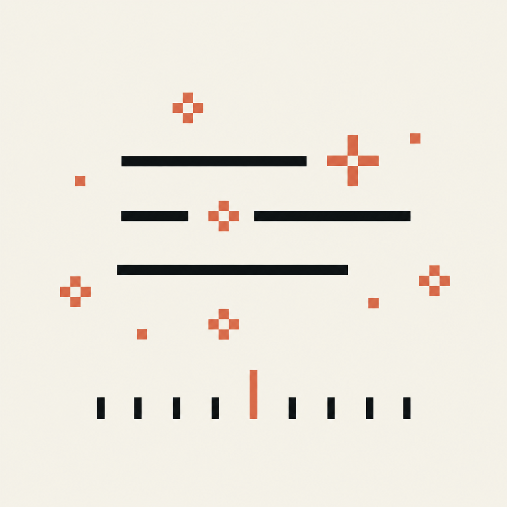

# ScreenMemo

로컬에서 동작하는 Android용 스마트 스크린샷 기록 및 검색 도구. 자동 기록한 화면을 OCR과 AI 어시스턴트로 다시 찾고 돌아볼 수 있습니다.

"화면엔 흔적 없이, 기억엔 흔적을"

[](https://dart.dev) [](https://www.android.com) [](LICENSE) [](https://github.com/woijfwefw/ScreenMemo/releases)

</div>

<p align="center">
  <b>언어</b>:
  <a href="README.md">简体中文</a> |
  <a href="README.en.md">English</a> |
  <a href="README.ja.md">日本語</a> |
  한국어
</p>

---

## 프로젝트 개요

ScreenMemo는 로컬에서 동작하는 스마트 스크린샷 기록 및 검색 도구입니다. Android 기기 화면을 자동으로 기록하고, OCR과 AI 어시스턴트로 정보를 검색 가능하게 만들어 필요할 때 단서를 빠르게 다시 찾고 맥락을 복원할 수 있게 합니다.

### 오늘부터 나만의 디지털 기억을 쌓아 보세요

**왜 지금 바로 시작해야 할까요?**

- **되돌릴 수 없는 지식의 손실**: 점점 더 많은 사람이 일상 데이터를 개인 AI에 먹이기 시작하는 지금, 기록되지 않은 하루하루는 미래의 AI 어시스턴트가 당신을 깊이 이해할 수 있는 근거를 조금씩 잃게 만듭니다.
- **조용히 벌어지는 시간의 복리 효과**: 데이터는 단기간에 몰아서 만들 수 없습니다. 오늘부터 디지털 표본을 차곡차곡 쌓기 시작한 사람은, AI가 다음 도약을 맞이할 때 다른 사람이 쉽게 따라오기 어려운 자신만의 기억 저장고를 자연스럽게 갖게 됩니다.
- **흩어진 디지털 자아를 다시 건져 올리기**: 당신에게 가장 소중한 맥락은 여러 앱과 기기 곳곳에 흩어져 있는 경우가 많습니다. ScreenMemo가 그것들을 잘 붙잡아 두지 않으면, 시간과 함께 사라져 다시 온전히 되살리기 어려워집니다.

## 앱 스크린샷

아래 스크린샷은 기능 주제별로 묶은 이미지입니다. 각 이미지는 하나의 완전한 사용 흐름을 보여 줍니다.

<table>
  <tr>
    <td align="center" valign="top">
      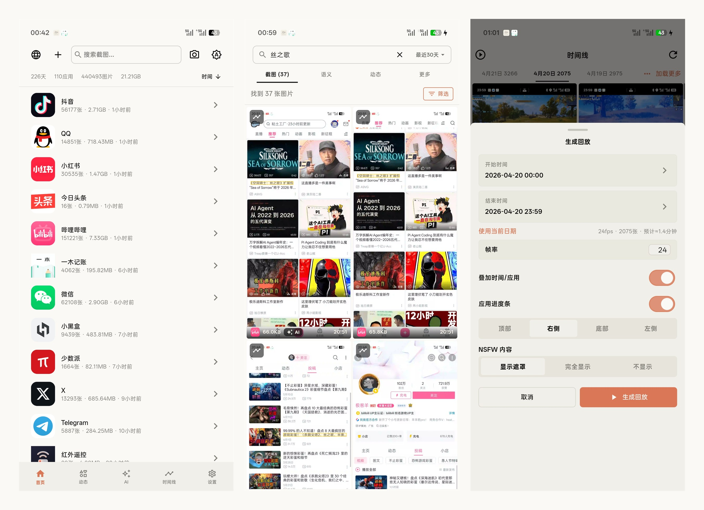
      <div align="center"><sub>핵심 진입점: 기록, 검색, 타임라인</sub></div>
    </td>
    <td align="center" valign="top">
      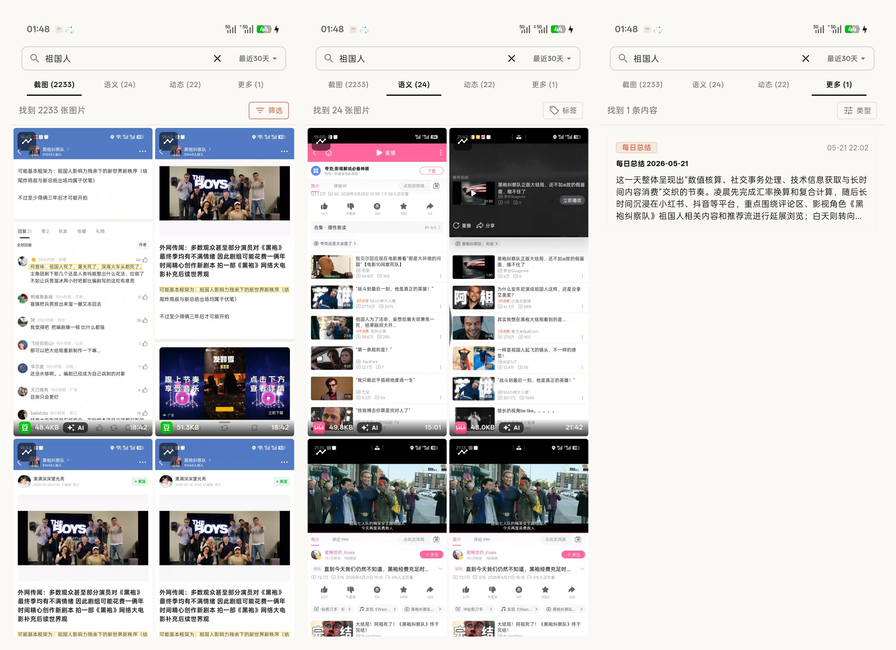
      <div align="center"><sub>검색과 결과 요약</sub></div>
    </td>
  </tr>
  <tr>
    <td align="center" valign="top">
      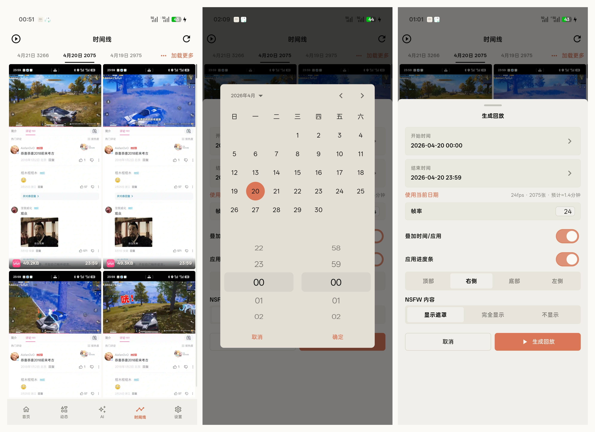
      <div align="center"><sub>타임라인, 캘린더, 리플레이 생성</sub></div>
    </td>
    <td align="center" valign="top">
      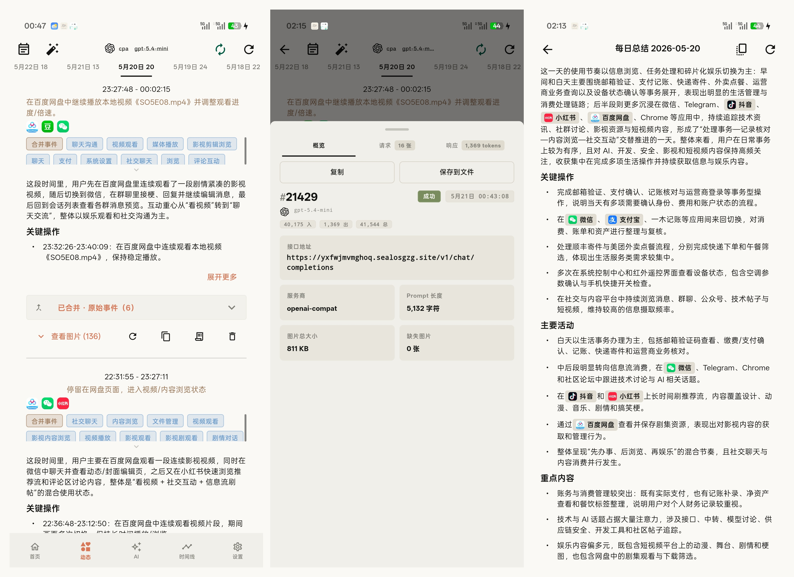
      <div align="center"><sub>AI 리뷰, 일일 요약, 요청 로그</sub></div>
    </td>
  </tr>
  <tr>
    <td align="center" valign="top">
      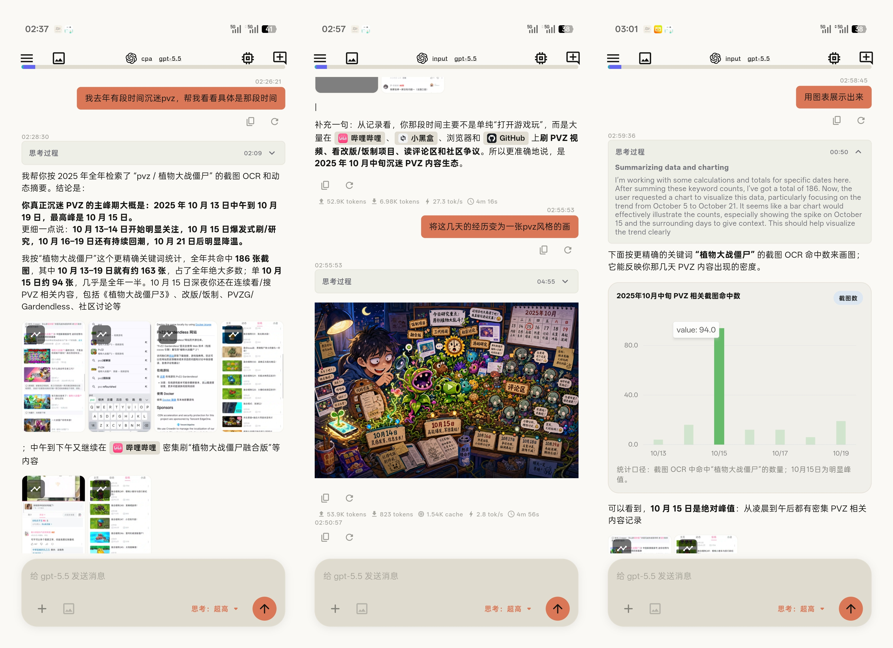
      <div align="center"><sub>AI 메모리 검색과 차트 정리</sub></div>
    </td>
    <td align="center" valign="top">
      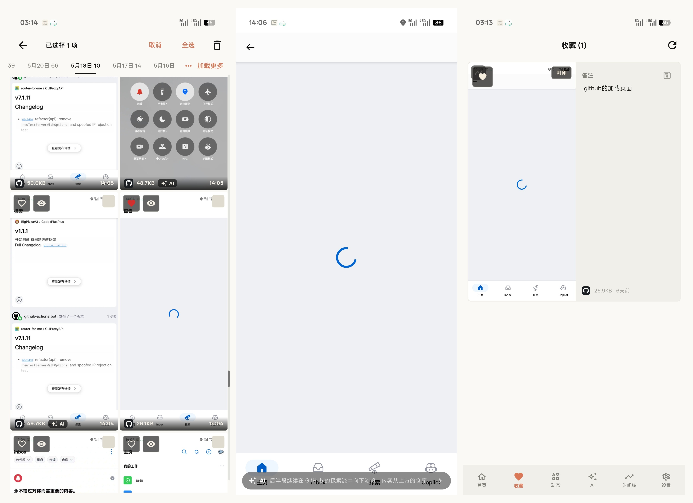
      <div align="center"><sub>즐겨찾기, 로딩 상태, 메모</sub></div>
    </td>
  </tr>
  <tr>
    <td align="center" valign="top">
      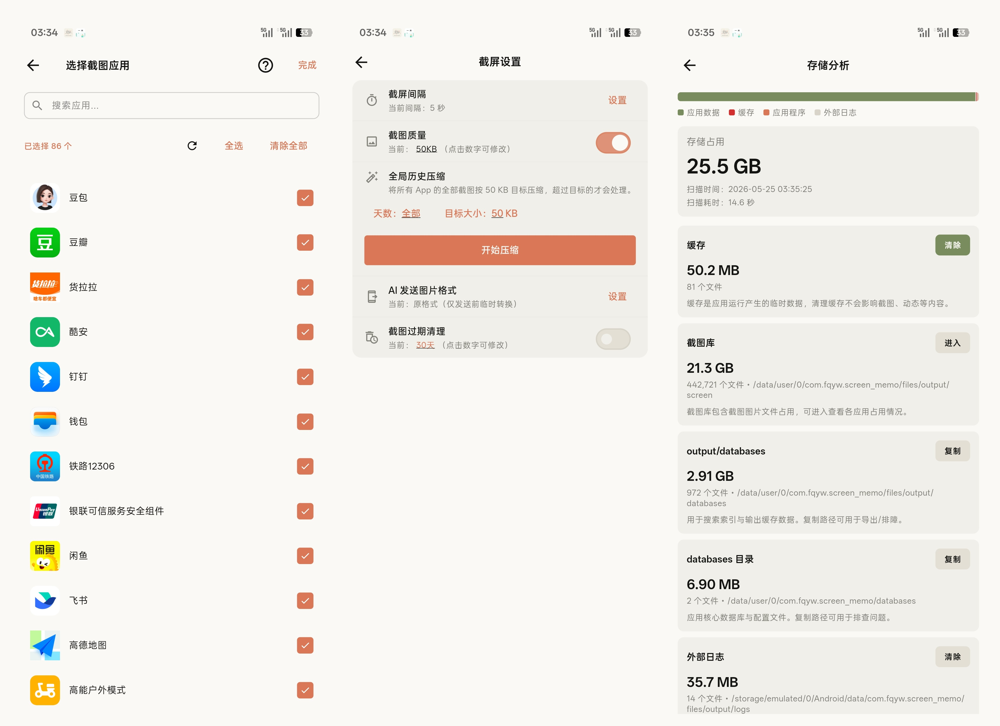
      <div align="center"><sub>캡처 설정, 압축, 저장소 분석</sub></div>
    </td>
    <td align="center" valign="top">
      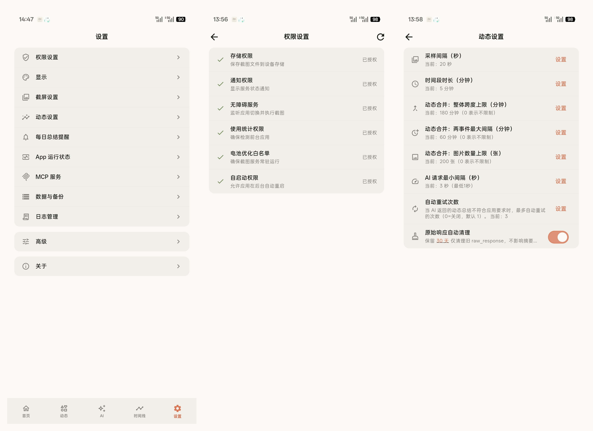
      <div align="center"><sub>설정, 권한, 동적 작업</sub></div>
    </td>
  </tr>
  <tr>
    <td align="center" valign="top">
      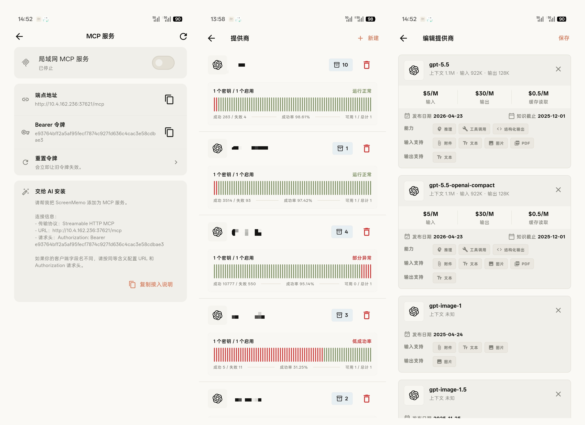
      <div align="center"><sub>MCP 서비스, AI 제공자, 시맨틱 모델</sub></div>
    </td>
    <td align="center" valign="top">
      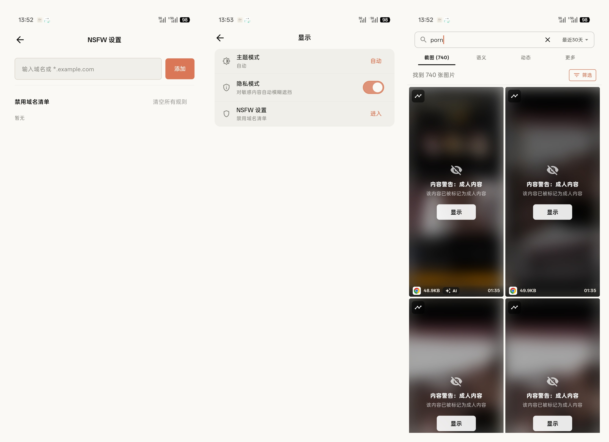
      <div align="center"><sub>프라이버시 모드와 민감 콘텐츠 제어</sub></div>
    </td>
  </tr>
</table>

## 빠른 시작

### 일반 사용자: APK 설치 파일 다운로드

휴대폰에서 ScreenMemo 를 사용하기만 하면 된다면 GitHub Releases 에서 미리 빌드된 APK 를 설치하는 것을 권장합니다. Flutter, Android Studio, 로컬 소스 빌드는 필요하지 않습니다.

1. [GitHub Releases](https://github.com/woijfwefw/ScreenMemo/releases)를 열고 최신 버전으로 이동합니다.
2. **Assets** 에서 휴대폰에 맞는 `screen_memo-...-app-*-release.apk` 패키지를 다운로드합니다. 최근 Android 휴대폰 대부분은 `arm64-v8a` 를 선택하면 됩니다. 확실하지 않다면 휴대폰 모델명을 함께 적어 커뮤니티 채팅에서 질문하세요.
3. APK 를 휴대폰으로 옮겨 설치합니다. Android 가 "알 수 없는 출처" 또는 설치 위험을 경고하면, 파일이 이 프로젝트의 Releases 페이지에서 받은 것인지 확인한 뒤 브라우저나 파일 관리자에 알 수 없는 앱 설치를 허용하세요.
4. 처음 실행한 뒤 앱 안내에 따라 필요한 권한을 켜세요. 자동 캡처 주요 기능은 Android 11 (API 30)+ 가 필요하며, 접근성 서비스, 사용 기록 접근, 배터리 최적화 예외 허용을 권장합니다.

### 개발자: 소스에서 실행

#### 요구 사항

- **Flutter SDK**: `3.35.7` (현재 CI 검증 버전)
- **Dart SDK**: `3.9.2` (Flutter `3.35.7` 에 포함, 프로젝트 제약은 `>=3.8.1`)
- **JDK**: `17` 권장 (CI는 `17` 사용, Android bytecode target 은 Java 11)
- **Android SDK**: Release 워크플로는 `Platform 36`, `Build-Tools 36.0.0`, `NDK 27.0.12077973` 사용
- **현재 APK 빌드 설정**: `minSdk 24`, `targetSdk 36`
- **주요 기능 플랫폼 요구 사항**: 자동 캡처는 Android 11 (API 30)+ 필요
- **IDE**: Android Studio / VS Code + Flutter 플러그인

#### 설치 및 실행

1. **저장소 클론**
   ```bash
   git clone <repository-url>
   cd screen_memo
   ```

2. **의존성 설치**
   ```bash
   flutter pub get
   ```

3. **다국어 코드 생성**
   ```bash
   flutter gen-l10n
   ```

4. **앱 실행**
   ```bash
   flutter run
   ```

#### Android 에뮬레이터에서 테스트

1. Android Studio **Device Manager** 에서 Android 11+ AVD 생성
2. 에뮬레이터를 시작한 뒤 다음 실행:
   ```bash
   flutter emulators
   flutter devices
   flutter run -d <device_id>
   ```

관리자용 개발 메모는 [`docs/DEVELOPMENT.md`](docs/DEVELOPMENT.md)를 참고하세요.

#### 개발 및 검증 명령

```bash
# 정적 분석
flutter analyze

# Flutter 테스트
flutter test

# i18n 감사
dart run tool/i18n_audit.dart --check

# Debug APK
flutter build apk --debug

# Release APK (ABI 분할)
flutter build apk --release --split-per-abi --tree-shake-icons --obfuscate --split-debug-info=build/symbols
```

#### 기능 테스트와 회귀 보호

Android JVM 단위 테스트:

**Windows**
```powershell
cd android
.\gradlew.bat test
```

**macOS / Linux**
```bash
cd android
./gradlew test
```

## MCP 서비스

ScreenMemo 는 휴대폰에서 읽기 전용 LAN MCP 서비스를 수동으로 켤 수 있습니다. 같은 로컬 네트워크의 AI 클라이언트는 동적 요약, 검색 결과, 컨텍스트 조각, 명시적으로 요청한 소수의 증거 이미지를 읽을 수 있습니다.

- Android 앱의 "설정 → MCP 서비스"에서 LAN MCP 서비스를 수동으로 켭니다.
- Endpoint 는 `http://<phone-lan-ip>:37621/mcp` 로 고정되며, 요청에는 `Authorization: Bearer <token>` 이 필요합니다.
- 표준 MCP 클라이언트는 `tools/list` 로 도구를 가져오고 `tools/call` 로 호출해야 합니다. 일부 클라이언트 호환성을 위해 선언된 도구 이름을 JSON-RPC `method` 로 직접 호출할 수도 있습니다.
- 기본적으로 OCR 원문이나 이미지 base64 는 반환하지 않습니다. 도구 매개변수에서 `include_ocr` 를 명시적으로 켜거나 `get_evidence_images` 를 호출할 때만 수량과 길이 제한이 있는 민감 콘텐츠를 반환합니다.
- 포트 `37621` 이 사용 중이면 설정 화면에 시작 오류가 표시되며, 임의 포트로 자동 전환하지 않습니다.

## FAQ

<details>
<summary>한 달에 저장 공간을 얼마나 쓰나요?</summary>

- 예시: 압축된 이미지가 약 50 KB이고 1분마다 1장을 캡처하면, 30일 기준 약 43,200장, 약 2.1 GB / 월 정도입니다
- 계산식: 월 사용량(GB) ≈ `(60 ÷ 간격 초) × 60 × 24 × 30 × 이미지 크기(KB) ÷ 1024 ÷ 1024`
- 절감 방법: 캡처 간격 늘리기, 목표 크기 압축 사용, 만료 정리 활성화, 필요한 앱만 기록하기
- 기존 과거 스크린샷은 "설정 → 스크린샷 설정 → 전역 기록 압축"에서 목표 크기로 일괄 압축할 수 있습니다. 취소하면 새 이미지 처리 작업 시작이 즉시 중단됩니다
- 리플레이 비디오가 시스템 갤러리에 저장되면 앱 내부의 임시 비디오 사본은 자동으로 삭제됩니다. 기존 리플레이 사본은 "저장소 분석 → 리플레이 비디오"에서 정리할 수 있습니다
</details>

<details>
<summary>데이터가 클라우드로 업로드되나요?</summary>

- 기본적으로는 아닙니다. 스크린샷, OCR, 인덱스, 통계, 대부분의 설정은 로컬에 남습니다
- AI 기능을 명시적으로 활성화한 경우에만 설정한 제공자에게 요청이 전송됩니다
</details>

<details>
<summary>어떤 AI 제공자를 쓸 수 있나요?</summary>

- 현재 내장 제공자 유형은 `OpenAI`, `Azure OpenAI`, `Claude`, `Gemini`, `Custom` 입니다
</details>

<details>
<summary>백업이나 마이그레이션은 어떻게 하나요?</summary>

- 백업 기능에서 ZIP 백업을 내보낼 수 있으며, 먼저 범위를 스캔하고 manifest를 만든 뒤 진행률을 보여 줍니다
- 가져오기는 덮어쓰기 / 병합 모드를 모두 지원하며, 병합 모드는 기존 데이터를 유지하면서 중복 제거를 시도합니다
- 병합 가져오기는 `output` 아래의 스크린샷, 인덱스, 데이터베이스 데이터만 병합합니다. 전체 백업의 `shared_prefs`, `app_flutter`, `no_backup` 같은 런타임 설정 루트는 자동으로 건너뜁니다
- 큰 백업이나 여러 백업은 먼저 데스크톱 병합 도구로 합친 뒤 Android로 가져오는 것이 실용적입니다
- OCR 또는 인덱스 상태가 빠졌다면 가져오기 진단 기능에서 진단과 복구를 실행할 수 있습니다
- 백업에는 cache, code cache, 임시 썸네일, 외부 로그가 포함되지 않습니다
</details>

<details>
<summary>배터리 / 성능 영향은 어떤가요?</summary>

- 주요 변수는 캡처 간격, 압축 정책, AI 재구축 빈도, 그리고 기기가 백그라운드에서 앱을 얼마나 잘 유지하는지입니다
- 실사용에서는 목표 크기 압축, 만료 정리, 앱별 캡처 정책 조합을 권장합니다
</details>

## 데스크톱 백업 병합 도구

휴대폰에서 여러 개의 큰 백업 ZIP 을 병합하는 것은 느릴 수 있으므로 별도 엔트리 `lib/main_desktop_merger.dart` 를 제공합니다.

- 여러 ZIP 백업과 출력 디렉터리 선택
- 병합 시작 전 구조 사전 점검 수행
- 백업의 `output` 트리를 병합하면서 스크린샷, 샤드 DB, 메인 메타데이터의 중복을 건너뜀
- 즐겨찾기, NSFW 플래그, 사용자 설정 같은 메타데이터도 병합
- 실시간 진행률, 경고, 영향 앱, 중복 제거 결과 표시
- 병합 결과를 새 ZIP 으로 다시 패키징

### 빌드 명령

**Windows**
```powershell
flutter build windows -t lib/main_desktop_merger.dart --release
```

**macOS**
```bash
flutter build macos -t lib/main_desktop_merger.dart --release
```

**Linux**
```bash
flutter build linux -t lib/main_desktop_merger.dart --release
```

## 권한

| 권한 | 용도 | 권장 |
| --- | --- | --- |
| 알림 | 전경 서비스, 내보내기 / 복구 / 재구축 진행률, 일일 알림 | 권장 |
| 접근성 서비스 | 자동 캡처, 활동 재구축, 일부 백그라운드 AI 흐름 | 핵심 기능에 필수 |
| 사용 기록 접근 | 전경 앱 판별, 앱 단위 필터링과 통계 | 강력 권장 |
| 설치된 앱 가시성 | 앱 선택, 새로 설치된 앱 자동 추가, 필터링, 통계를 위해 설치된 앱 목록 조회 | 메인 앱 선택 흐름에 필요 |
| 배터리 최적화 예외 / 자동 시작 | 백그라운드 캡처와 재구축 안정성 향상 | 강력 권장 |
| 정확한 알람 | 일일 요약 알림 | 선택 사항 |
| 사진 / 다운로드 쓰기 | 스크린샷, 리플레이 비디오, 내보내기 결과 저장 | 선택 사항 |

## 국제화

README 와 앱 UI 는 현재 다음 4개 언어를 대상으로 유지됩니다.

- 간체 중국어
- English
- 일본어
- 한국어

앱 UI 문구는 `lib/l10n/app_*.arb`에서 관리하고, Android 네이티브 알림·권한 설명·포그라운드 서비스 문구는 `android/app/src/main/res/values*/strings.xml`에서 관리합니다. 새 UI 문구를 Dart Widget이나 Android XML 속성에 직접 하드코딩하지 말고, 각 언어 리소스를 먼저 추가한 뒤 `flutter gen-l10n`을 다시 실행하세요.

자주 쓰는 명령:

```bash
# l10n 코드 생성
flutter gen-l10n

# ARB 일관성 / 플랫폼 번역 / UI 하드코딩 회귀 검사
dart run tool/i18n_audit.dart --check

# 예외를 확인한 뒤 baseline 갱신
dart run tool/i18n_audit.dart --update-baseline
```

`flutter test` 는 `test/i18n_audit_test.dart` 를 자동 실행해 다국어 회귀를 막습니다.

## 기여하기

버그 제보, 제안, 코드 기여를 환영합니다.

1. 저장소를 Fork
2. 브랜치 생성: `git checkout -b feature/your-change`
3. 변경 커밋: `git commit -m "feat: describe your change"`
4. 브랜치 푸시: `git push origin feature/your-change`
5. Pull Request 생성

제출 전 권장 명령:

- `flutter analyze`
- `flutter test`
- `dart run tool/i18n_audit.dart --check`
